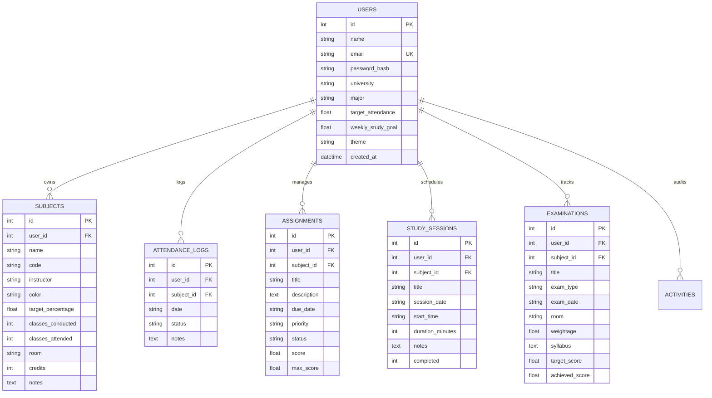

# StudentOS — Personal University Student Management Platform

> An intelligent, Apple- & Notion-inspired productivity and academic management platform built for modern university students.

StudentOS replaces fragmented spreadsheets, notes, and calendar reminders with a unified, high-performance command center. Track coursework, calculate safe absence limits ("bunk math") in real time, monitor assignment queues, schedule daily focus blocks, and count down to major examinations.

---

## 1. Project Architecture

StudentOS follows a clean, decoupled architecture with a unified production runtime:

```
student-os/
├── backend/
│   ├── data/
│   │   └── studentos.db          # Persistent SQLite database (WAL Mode)
│   ├── routers/
│   │   ├── auth_router.py        # JWT authentication & profile endpoints
│   │   ├── dashboard_router.py   # Aggregated KPI & summary calculations
│   │   ├── subjects_router.py    # Subject CRUD & quick-attendance actions
│   │   ├── assignments_router.py # Assignment CRUD, filtering & status toggles
│   │   ├── study_router.py       # Study session scheduling & weekly stats
│   │   ├── exams_router.py       # Examination scheduler & countdown data
│   │   ├── analytics_router.py   # Chart data payloads & academic health score
│   │   └── export_router.py      # Full JSON & attendance CSV export
│   ├── auth.py                   # Secure password hashing (bcrypt) & JWT tokens
│   ├── database.py               # SQLite connection pool, schemas & migrations
│   ├── models.py                 # Pydantic v2 data validation schemas
│   ├── seed.py                   # Comprehensive demo university profile seeder
│   ├── main.py                   # FastAPI application & SPA static server
│   ├── requirements.txt          # Backend dependencies
│   └── test_e2e.py               # Automated end-to-end integration test suite
├── frontend/
│   ├── src/
│   │   ├── api/
│   │   │   └── client.js         # REST API client with auto-injected Bearer tokens
│   │   ├── context/
│   │   │   ├── AuthContext.jsx   # Global session state & persistence
│   │   │   └── ThemeContext.jsx  # Dark/Light mode engine
│   │   ├── components/
│   │   │   ├── common/           # Modal, StatCard, Badge, Toast, CountdownTimer, FocusTimer
│   │   │   └── layout/           # Collapsible Sidebar & Header
│   │   ├── views/
│   │   │   ├── DashboardView.jsx # Academic command center & priority feed
│   │   │   ├── AttendanceView.jsx# Subject cards & interactive bunk simulator
│   │   │   ├── AssignmentsView.jsx# Kanban board & table with overdue alerts
│   │   │   ├── StudyPlannerView.jsx# Daily & weekly timeline with Pomodoro
│   │   │   ├── ExaminationsView.jsx# Live countdown clocks & syllabus checklists
│   │   │   ├── AnalyticsView.jsx # Recharts visualizations & streak analysis
│   │   │   ├── SettingsView.jsx  # Preferences, theme & data backup
│   │   │   └── AuthView.jsx      # Apple/Notion split-screen authentication
│   │   ├── App.jsx               # Main view coordinator
│   │   ├── index.css             # Tailwind layers & sleek UI utilities
│   │   └── main.jsx              # React 19 root
│   ├── tailwind.config.js
│   ├── vite.config.js
│   └── package.json
├── package.json                  # Root npm scripts
├── start.bat                     # 1-Click Windows execution script
├── start.sh                      # 1-Click Linux / macOS execution script
└── README.md                     # Documentation
```

---

## 2. Technology Stack

* **Frontend Framework**: React 19 + Vite 8
* **Styling & Design System**: Tailwind CSS 3.4 with custom Apple/Notion color palettes, rounded cards, subtle border elevations, and dark/light mode
* **Icons**: Lucide React
* **Visualizations & Charts**: Recharts 3
* **Micro-interactions**: Canvas Confetti + Web Audio API synthesizer chimes
* **Backend Framework**: Python 3 (FastAPI + Starlette + Uvicorn)
* **Database**: Persistent SQLite with WAL (Write-Ahead Logging) journal mode and Foreign Key constraints
* **Security & Auth**: JWT (JSON Web Tokens via python-jose) + direct bcrypt password hashing
* **Data Validation**: Pydantic v2

---

## 3. Database Schema

The database guarantees strict multi-tenant isolation. Every entity references `users.id` with `ON DELETE CASCADE`:



---

## 4. Mathematical Bunk & Attendance Algorithm

For any subject with $A$ classes attended, $C$ classes conducted, and required target percentage $T = \frac{\text{Target\%}}{100}$:

1. **Current Attendance Rate**:
   $$\text{Rate} = \frac{A}{C} \times 100\%$$

2. **When Attendance is Above Target ($\text{Rate} \ge T$):**
   How many upcoming classes can the student safely miss without dropping below $T$?
   $$\frac{A}{C + y} \ge T \implies A \ge T(C + y) \implies y \le \frac{A - T \cdot C}{T} = \left\lfloor \frac{A}{T} - C \right\rfloor$$
   $$\text{Safe Bunks} = \max\left(0, \left\lfloor \frac{A}{T} - C \right\rfloor\right)$$

3. **When Attendance is Below Target ($\text{Rate} < T$):**
   How many consecutive classes must the student attend without missing any to restore attendance back to $T$?
   $$\frac{A + x}{C + x} \ge T \implies A + x \ge T \cdot C + T \cdot x \implies x(1 - T) \ge T \cdot C - A$$
   $$\text{Required Consecutive Classes} = \max\left(1, \left\lceil \frac{T \cdot C - A}{1 - T} \right\rceil\right)$$

---

## 5. Key Functional Modules

### 1. Personalized Academic Dashboard
* Time-of-day contextual greeting ("Good morning, Alex!")
* Dynamic live date and clock
* Top KPI indicators: Overall Attendance %, Pending Assignments, Upcoming Exams, Today's Study Hours
* Real-time next examination countdown card
* 1-Click today's study schedule check-off
* Quick attendance check-in strip

### 2. Attendance Management & Bunk Simulator
* Subject cards with circular and linear visual progress bars
* 1-Click quick actions: `✓ Attended (+1)` and `✕ Missed (+0/+1)`
* Interactive target slider (simulate 50% to 95% attendance thresholds dynamically)
* Subject history drawer with historical class check-ins

### 3. Assignment Manager
* Add assignments with subject links, deadline date/time picker, priority levels (`Low`, `Medium`, `High`, `Urgent`), and status (`Pending`, `In Progress`, `Completed`)
* Automatic overdue detection (highlighted in red with `OVERDUE` badge)
* Due soon indicator (within 48 hours)
* Instant toggle between **Kanban Board View** and **List/Table View**
* Filter by subject, status, priority, and keyword search

### 4. Daily & Weekly Study Planner
* Toggle between **Daily View** and **Weekly Schedule**
* Week progress bar against personalized study goal (e.g. 20 hours/week)
* Integrated **Pomodoro Focus Timer** (25m Pomodoro, 50m Deep Work, 5m Break, with Web Audio chime and automatic session logger)
* Celebratory confetti micro-interaction upon marking sessions completed

### 5. Examination Hub & Live Countdown
* Countdown clocks ticking down Days, Hours, Minutes, and Seconds
* Exam types: Midterm, Final, Quiz, Lab Practical, Project Review
* Syllabus and topic preparation checklist
* Weightage and target score tracking
* Completed examinations archive

### 6. Performance Analytics
* Interactive Recharts visualizations:
  * Subject Attendance vs Target Bar Chart (with target reference line)
  * Weekly Study Time Area Chart
  * Assignment Status Breakdown Donut Chart
  * 14-Day Attendance Log Trend
* Key Academic Health metrics: Study streak, strongest course, course needing attention

### 7. Data Export & Backup
* Download entire student profile, subjects, logs, assignments, study sessions, and exams as clean JSON
* Export historical attendance records as CSV format

---

## 6. Setup and Running Instructions

### Prerequisites
* Python 3.10+
* Node.js 18+ (only needed if modifying frontend source code)

### Method A: 1-Click Launch (Recommended)
On Windows:
Double-click `start.bat`.

On Linux / macOS:
```bash
chmod +x start.sh
./start.sh
```

The unified server will start on `http://localhost:8000` and automatically serve both the backend API and the compiled React frontend.

### Method B: Manual Startup

1. **Install backend dependencies:**
   ```bash
   cd backend
   pip install -r requirements.txt
   ```

2. **Run backend unified server:**
   ```bash
   python main.py
   ```
   Open `http://localhost:8000` in your browser.

3. **(Optional) Run in Dual-Dev Mode with Vite HMR:**
   In Terminal 1 (Backend):
   ```bash
   cd backend
   python main.py
   ```
   In Terminal 2 (Frontend):
   ```bash
   cd frontend
   npm run dev
   ```
   Open `http://localhost:5173`. Requests to `/api` are automatically proxied to port 8000.

---

## 7. Demo Account Credentials

StudentOS comes pre-seeded with a comprehensive demo university student:

* **Email**: `demo@studentos.dev`
* **Password**: `student123`
* **Or simply click**: `"Launch Demo Workspace (1-Click)"` on the sign-in screen.

---

## 8. Deployment Instructions

### Docker Deployment
Create a `Dockerfile` in the root:
```dockerfile
FROM node:20-alpine AS build
WORKDIR /app/frontend
COPY frontend/package*.json ./
RUN npm install
COPY frontend ./
RUN npm run build

FROM python:3.11-slim
WORKDIR /app
COPY backend/requirements.txt ./
RUN pip install --no-cache-dir -r requirements.txt
COPY backend/ ./backend/
COPY --from=build /app/frontend/dist ./frontend/dist
EXPOSE 8000
CMD ["python", "backend/main.py"]
```
Build and run:
```bash
docker build -t studentos .
docker run -p 8000:8000 -v studentos_data:/app/backend/data studentos
```

---

## 9. Known Limitations

* **Notification System**: Currently notifications are delivered through in-app visual badges and toast banners; external email/SMS reminders can be added with an SMTP service.
* **Database**: Uses SQLite with WAL mode, suitable for single-instance university deployments or personal student hosting. For enterprise multi-campus deployments with distributed nodes, switch the SQLAlchemy/DB connection string to PostgreSQL.

---

## License

MIT License. Designed with care for students worldwide.
